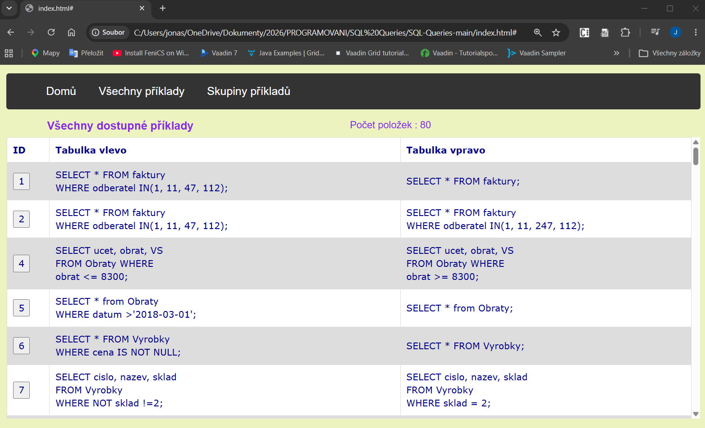
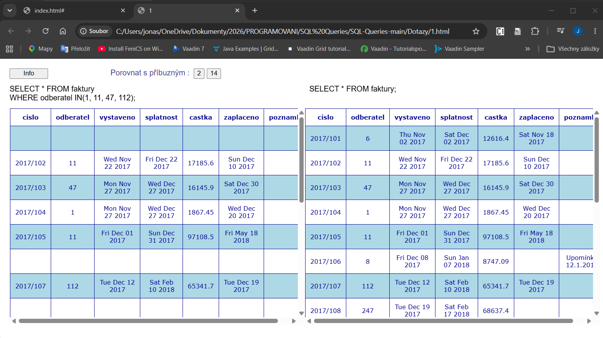

# SQL-Queries
Stránky zobrazují porovnání páru SQL dotazu.

## Dostupné verze:
1) soubor html
2) exportované tabulky do md - beta verze

## Soubor html - postup spuštění:
1) Stáhnout tento projekt a rozbalit v PC
2) Otevřít soubor [z počítače](https://github.com/jonasRower/SQL-Queries/blob/main/index.html)
3) Měl by se zobrazit soubor html 
4) Mělo by se zobrazit porovnání, jako např. : 
   

